<div align="center">



# 🧬 Awesome Single-Cell Genomics

<a href="https://github.com/ishandutta2007/Awesome-Awesome-Awesome"></a><a href="https://discord.gg/jc4xtF58Ve"></a> [](https://github.com/ishandutta2007/Awesome-Single-Cell-Genomics/pulls) <a href="https://github.com/ishandutta2007/Awesome-Single-Cell-Genomics/stargazers"></a> <a href="https://github.com/ishandutta2007/Awesome-Single-Cell-Genomics/network/members"></a> <a href="https://opensource.org/licenses/MIT"></a> <a href="https://github.com/ishandutta2007"></a>

**A definitive, curated directory of SaaS platforms, computational frameworks, open-source software, and AI foundation models for Single-Cell Genomics, scRNA-seq, scATAC-seq, Spatial Transcriptomics, and Multi-Omics Integration.**

</div>

---

## 📑 Table of Contents

- [🔍 SEO & Domain Keywords](#-seo--domain-keywords)
- [📊 Sector Overview & Market Dynamics](#-sector-overview--market-dynamics)
- [☁️ SaaS & Hosted Platforms](#️-saas--hosted-platforms)
- [💻 Open-Source Repositories (Ranked by Stars)](#-open-source-repositories-ranked-by-stars)
- [🔬 Additional Specialized Open-Source Tools](#-additional-specialized-open-source-tools)
- [🛠️ Standard scRNA-seq Analysis Pipeline Architecture](#️-standard-scrna-seq-analysis-pipeline-architecture)
- [🤝 How to Contribute](#-how-to-contribute)
- [📈 Star History](#-star-history)
- [💖 Support & Sponsoring](#-support--sponsoring)
- [📜 Disclaimer](#-disclaimer)

---

## 🔍 SEO & Domain Keywords

`single-cell genomics` • `scRNA-seq` • `single-cell RNA sequencing` • `scATAC-seq` • `spatial transcriptomics` • `multi-omics integration` • `cell-type annotation` • `trajectory inference` • `RNA velocity` • `AnnData` • `SingleCellExperiment` • `Seurat` • `Scanpy` • `scvi-tools` • `scGPT` • `bioinformatics pipelines` • `computational biology` • `flow cytometry` • `CyTOF` • `doublet detection` • `batch effect correction` • `gene regulatory networks` • `10x Genomics`

---

## 📊 Sector Overview & Market Dynamics

The global single-cell analysis and genomics market is valued at approximately **$4.8B – $5.5B in 2025–2026** and is projected to expand at a compound annual growth rate (CAGR) of **15.2% to exceed $13.5B by 2032**, propelled by expanding clinical oncology applications, spatial multi-omics adoption, and AI-driven drug discovery pipelines.

The market exhibits a distinct bifurcation: the upstream instrumentation and primary sequencing ecosystem is **highly concentrated** (an oligopoly dominated by Illumina, 10x Genomics, and Becton Dickinson benefiting from protected consumable chemistry, microfluidics, and flow cell hardware patents), whereas the downstream computational software and analytical tooling landscape is **moderately to highly fragmented**, split between dominant open-source community frameworks (R/Seurat, Python/scverse, Bioconductor) and specialized commercial SaaS platforms competing on regulatory compliance (HIPAA, FedRAMP, GxP), automated workflow orchestration, and no-code graphical interfaces for laboratory biologists.

---

## ☁️ SaaS & Hosted Platforms

A comprehensive comparison of leading enterprise and commercial SaaS platforms for single-cell genomics, sequencing secondary analysis, and high-dimensional cytometry. Sorted by **Company Scale (Revenue / Valuation)** in descending order.

| 🏢 Platform / Product | 🌐 Organization / Parent | 📈 Company Scale (Valuation / Revenue) | 💳 Pricing (Starting Tier) | 🎁 Free Tier / Trial Limit | 🎯 Key Capabilities & Primary Focus |
| :--- | :--- | :--- | :--- | :--- | :--- |
| **[Cytobank](https://www.cytobank.org/)** | Beckman Coulter / Danaher Corporation | **~$180B Market Cap** ($23.8B Annual Revenue) | **$2,100 / seat / year** (Academic Tier); **$4,800 / seat / year** (Commercial Tier) | **30-day free trial**; includes up to 10 experiments, 500 MB cloud storage, viSNE, SPADE, & FlowSOM | Cloud platform for high-dimensional single-cell flow & mass cytometry (CyTOF) analysis with automated ML clustering. |
| **[FlowJo & FlowJo Portal](https://www.flowjo.com/)** | BD Biosciences / Becton, Dickinson and Company | **~$68B Market Cap** ($20.2B Annual Revenue) | **$440 / user / year** (Academic License); **$1,050 / user / year** (Commercial License) | **30-day full-featured trial** with hardware ID or FlowJo Portal registration; unlimited analysis | The global benchmark software for single-cell flow cytometry gating, immune profiling, and phenotyping plugins. |
| **[Illumina BaseSpace](https://www.illumina.com/products/by-type/informatics-products/basespace-sequence-hub.html)** | Illumina, Inc. | **~$22B Market Cap** ($4.5B Annual Revenue) | **$1,200 / year** (BaseSpace Professional) or **$500** per 500 iCredits pack ($1.00 / iCredit) | **30-day free trial** with 1 TB cloud storage and standard run monitoring / FASTQ demultiplexing | Direct sequencer-to-cloud integration with automated demultiplexing and push-button scRNA-seq pipelines. |
| **[10x Genomics Loupe & Cloud](https://www.10xgenomics.com/products/cloud-analysis)** | 10x Genomics, Inc. | **~$2.1B Market Cap** ($620M Annual Revenue) | **$0.00** (Loupe Browser desktop); Cloud Analysis starts at **$5.00 / sample run** | **Free forever** desktop visualization tool for `.cloupe` files; **$500 free compute credits** on cloud registration | Official exploratory desktop browser and scalable cloud Cell Ranger analysis for Chromium & Visium assays. |
| **[DNAnexus Titan](https://www.dnanexus.com/)** | DNAnexus, Inc. | **~$1.3B Valuation** ($200M+ Series I Funding) | **$0.038 / vCPU-hour** compute + **$0.020 / GB / mo** storage ($6,000 / yr base platform seat) | **90-day trial** with **$500 in cloud compute & storage credits** upon community/academic registration | FedRAMP & HIPAA-compliant multi-omics cloud environment for reproducible Cell Ranger, Seurat, and custom workflows. |
| **[Velsera / Seven Bridges](https://www.sevenbridges.com/)** | Velsera / Summa Equity | **~$600M Valuation** (~$120M Annual Revenue) | **$0.05 / vCPU-hour** (+ cloud provider passthrough); Enterprise starting at **$15,000 / year** | **30-day free trial** with **$300 cloud execution credits** and 100 GB storage for CWL pipelines | Enterprise multi-cloud bioinformatics platform executing Common Workflow Language (CWL/WDL) single-cell pipelines. |
| **[LatchBio](https://latch.bio/)** | Latch AI, Inc. | **~$120M Valuation** ($33M Series A Funding) | **$0.10 / vCPU-hour** compute + **$0.023 / GB / mo** storage; Team Tier at **$500 / month** | **Free forever plan** with 50 GB storage, 10 compute hours/mo, and verified pipelines (nf-core/scrnaseq) | Serverless computational biology cloud with interactive browser GUI, DAG workflow execution, and cellxgene integration. |
| **[Partek Flow](https://www.partek.com/partek-flow/)** | Partek Inc. | **~$30M Valuation** (~$30M Annual Revenue) | **$3,500 / single-seat / year** (Academic); **$7,500 / single-seat / year** (Commercial) | **14-day full-featured free trial** for local workstation or server deployment (up to 5 active projects) | No-code visual workflow builder designed for biologists to analyze scRNA-seq, scATAC-seq, and spatial transcriptomics. |

---

## 💻 Open-Source Repositories (Ranked by Stars)

A curated catalog of open-source frameworks, algorithm toolkits, and foundation models for single-cell computational biology. Sorted in **descending order by GitHub stargazers**.

1. **[Seurat](https://github.com/satijalab/seurat)** [](https://github.com/satijalab/seurat/stargazers)  
   *The foundational R toolkit for single-cell genomics.*  
   Features multi-assay layers, bridge integration for cross-modality alignment (scRNA-seq + scATAC-seq), spatial transcriptomic niche analysis, and SCTransform variance stabilization. The global standard for R-based single-cell bioinformatics.

2. **[Scanpy](https://github.com/scverse/scanpy)** [](https://github.com/scverse/scanpy/stargazers)  
   *The primary Python toolkit for scalable single-cell data analysis.*  
   Built on AnnData, Scanpy powers preprocessing, highly variable gene selection, PCA, neighborhood graph construction, UMAP/t-SNE projection, Leiden clustering, and differential expression across millions of cells.

3. **[scvi-tools](https://github.com/scverse/scvi-tools)** [](https://github.com/scverse/scvi-tools/stargazers)  
   *Deep probabilistic generative modeling for single-cell omics.*  
   Implements variational autoencoders (VAEs) for batch correction (scVI), zero-shot cell-type annotation (scANVI), multi-modal integration (totalVI for CITE-seq), and spatial deconvolution (DestVI).

4. **[scGPT](https://github.com/bowang-lab/scGPT)** [](https://github.com/bowang-lab/scGPT/stargazers)  
   *Generative pretrained foundation model for single-cell biology.*  
   Trained on 33+ million single cells across diverse human tissues. Enables transfer learning, zero-shot cell type classification, perturbation response prediction, and gene network representation learning.

5. **[CellProfiler](https://github.com/CellProfiler/CellProfiler)** [](https://github.com/CellProfiler/CellProfiler/stargazers)  
   *Automated image analysis software for single-cell phenotypic profiling.*  
   Enables high-throughput segmentation, quantitative morphological measurements, and spatial feature extraction from fluorescence microscopy and cell imaging screens.

6. **[AnnData](https://github.com/scverse/anndata)** [](https://github.com/scverse/anndata/stargazers)  
   *The standard Python annotated data matrix structure for single-cell data.*  
   Stores gene expression matrices (`X`), cell metadata (`obs`), gene features (`var`), unstructured annotations (`uns`), and multi-dimensional embeddings (`obsm`) with fast HDF5/Zarr backing.

7. **[inferCNV](https://github.com/broadinstitute/infercnv)** [](https://github.com/broadinstitute/infercnv/stargazers)  
   *Inference of copy number variations from single-cell RNA-seq data.*  
   Developed by the Broad Institute to identify somatic large-scale chromosomal copy number alterations (amplifications and deletions) in tumor single-cell profiling.

8. **[Harmony](https://github.com/immunogenomics/harmony)** [](https://github.com/immunogenomics/harmony/stargazers)  
   *Fast, sensitive, and scalable batch effect integration for single-cell transcriptomics.*  
   Iteratively projects cells into low-dimensional space and applies soft k-means clustering to correct technical confounders while retaining genuine biological variation.

9. **[pySCENIC](https://github.com/aertslab/pySCENIC)** [](https://github.com/aertslab/pySCENIC/stargazers)  
   *Single-cell regulatory network inference and cell type regulon activity mapping.*  
   Discovers gene regulatory networks (GRNs) using co-expression analysis (GRNBoost2), motif enrichment (cisTarget), and regulon scoring (AUCell) in Python.

10. **[Squidpy](https://github.com/scverse/squidpy)** [](https://github.com/scverse/squidpy/stargazers)  
    *Spatial single-cell transcriptomics and tissue architecture analysis.*  
    Integrates spatial molecular coordinates with image processing, spatial neighborhood graphs, co-occurrence scores, ligand-receptor interactions, and spatial clustering in the scverse stack.

11. **[DoubletFinder](https://github.com/chris-mcginnis-ucsf/DoubletFinder)** [](https://github.com/chris-mcginnis-ucsf/DoubletFinder/stargazers)  
    *Identification of cell doublets in single-cell RNA sequencing.*  
    Simulates artificial heterotypic doublets from existing single-cell profiles and calculates a pANN score to flag and filter multiplet droplets in Seurat pipelines.

12. **[scVelo](https://github.com/theislab/scvelo)** [](https://github.com/theislab/scvelo/stargazers)  
    *RNA velocity generalized across dynamic single-cell transcription states.*  
    Solves the full transcriptional kinetic rate equations (spliced vs. unspliced mRNA) using a likelihood-based dynamical model to recover transient cellular dynamics and directional cell fates.

13. **[CellOracle](https://github.com/morris-lab/CellOracle)** [](https://github.com/morris-lab/CellOracle/stargazers)  
    *In silico gene perturbation analysis and gene regulatory network inference.*  
    Integrates single-cell transcriptomics with scATAC-seq chromatin accessibility to simulate the downstream phenotypic effects of transcription factor knockouts and overexpression.

14. **[Monocle 3](https://github.com/cole-trapnell-lab/monocle3)** [](https://github.com/cole-trapnell-lab/monocle3/stargazers)  
    *Single-cell lineage tracing, pseudotime progression, and differential expression.*  
    Uses reversed graph embedding and UMAP manifolds to reconstruct branching trajectories, track differentiation cascades, and detect trajectory-dependent genes.

15. **[CellRank](https://github.com/theislab/cellrank)** [](https://github.com/theislab/cellrank/stargazers)  
    *Fate mapping and lineage decision dynamics in cellular state spaces.*  
    Combines RNA velocity vectors, developmental pseudotime, and experimental timecourses with Markov chains to model fate probabilities and lineage driver genes.

16. **[nf-core/scrnaseq](https://github.com/nf-core/scrnaseq)** [](https://github.com/nf-core/scrnaseq/stargazers)  
    *Production-grade Nextflow pipeline for scRNA-seq processing.*  
    Automates end-to-end processing from raw FASTQ to count matrices using Cell Ranger, STARsolo, Alevin-fry, or Kallisto/Bustools with integrated MultiQC reporting.

17. **[Palantir](https://github.com/dpeerlab/Palantir)** [](https://github.com/dpeerlab/Palantir/stargazers)  
    *Pseudotime alignment and differentiation fate probability modeling.*  
    Models continuous cell differentiation as a Markov process over diffusion maps, computing differentiation potential and branch probabilities towards terminal states.

18. **[Muon](https://github.com/scverse/muon)** [](https://github.com/scverse/muon/stargazers)  
    *Multimodal omics analysis framework powered by MuData.*  
    Extends AnnData to handle coupled multimodal assays including CITE-seq (RNA + protein), 10x Multiome (RNA + ATAC), and spatial multi-omics in a unified data structure.

19. **[Dyno / Dynverse](https://github.com/dynverse/dyno)** [](https://github.com/dynverse/dyno/stargazers)  
    *Unified platform for single-cell trajectory inference evaluation.*  
    Provides standardized wrappers for over 50 trajectory inference methods, automated benchmark comparisons, and publication-ready trajectory visualizations.

20. **[BBKNN](https://github.com/Teichlab/bbknn)** [](https://github.com/Teichlab/bbknn/stargazers)  
    *Fast batch-balanced k-nearest neighbors for single-cell graphs.*  
    Constructs neighbor graphs with balanced representation across technical batches, executing in seconds directly on high-dimensional PCA space within Scanpy.

21. **[velocyto](https://github.com/velocyto-team/velocyto.py)** [](https://github.com/velocyto-team/velocyto.py/stargazers)  
    *Estimation of RNA velocity in single cells from spliced and unspliced reads.*  
    The original framework that introduced RNA velocity by distinguishing newly transcribed precursor mRNAs from mature processed transcripts in droplet sequencing.

22. **[Azimuth](https://github.com/satijalab/azimuth)** [](https://github.com/satijalab/azimuth/stargazers)  
    *Reference-based automated cell-type annotation and projection.*  
    Leverages curated Human BioMolecular Atlas Program (HuBMAP) references to map query scRNA-seq datasets into reference UMAP space and predict cell types without manual re-clustering.

23. **[Compass](https://github.com/YosefLab/Compass)** [](https://github.com/YosefLab/Compass/stargazers)  
    *In silico single-cell metabolic flux balance analysis.*  
    Characterizes cellular metabolic states and metabolic heterogeneity from single-cell transcriptomes by integrating flux balance constraints with biochemical reaction databases.

---

## 🔬 Additional Specialized Open-Source Tools

- **[Bioconductor (SingleCellExperiment / scater / scran)](https://bioconductor.org/packages/SingleCellExperiment/)** 🧬  
  The foundational statistical bedrock of R-based single-cell genomics. `SingleCellExperiment` provides the standard S4 container; `scater` generates rigorous quality metrics; `scran` implements pooled deconvolution normalization for count matrices with high zero proportions.
- **[MORESCA](https://pypi.org/project/moresca/)** ⚙️  
  Modular and Reproducible Single-Cell Analysis pipeline. Standardizes complete scRNA-seq workflows using a single declarative Gin config file (`moresca -d data.h5ad -o output -p config.gin`), eliminating hardcoded scripts.
- **[Celline](https://pypi.org/project/celline/)** 🧪  
  End-to-end interactive scRNA-seq pipeline from raw FASTQ to biological insights. Features automated SRA/GEO retrieval, Cell Ranger execution, Scrublet doublet filtering, and an interactive web GUI with PBS cluster scheduling.
- **[CREST](https://pypi.org/project/crest-sc/)** 🦀  
  Chunked Rust Engine for Single-cell Transcriptomics. Provides out-of-core chunked processing validated against Scanpy, executing 7.1× faster on 68k PBMC benchmarks and analyzing 200,000+ cells without RAM exhaustion.
- **[Geneformer](https://huggingface.co/ctheodoris/Geneformer)** 🤖  
  Context-aware attention transformer foundation model trained on ~30 million single-cell transcriptomes for zero-shot cell state prediction and in silico network perturbation.
- **[SCassist](https://github.com/)** 💡  
  LLM-guided intelligent parameter tuning and differential expression interpretation assistant integrated with Seurat workflows.

---

## 🛠️ Standard scRNA-seq Analysis Pipeline Architecture

```
                               ┌────────────────────────────────────────────────────────┐
                               │           Raw Sequencing Reads (FASTQ)                 │
                               └──────────────────────────┬─────────────────────────────┘
                                                          ▼
                               ┌────────────────────────────────────────────────────────┐
                               │ Alignment & Counting: STARsolo / Cell Ranger / Alevin  │
                               └──────────────────────────┬─────────────────────────────┘
                                                          ▼
                               ┌────────────────────────────────────────────────────────┐
                               │ Quality Control: Filter Dead Cells, Doublet Removal    │
                               │   (Scrublet / DoubletFinder / scater mito% thresholds) │
                               └──────────────────────────┬─────────────────────────────┘
                                                          ▼
                               ┌────────────────────────────────────────────────────────┐
                               │ Normalization & Feature Selection (SCTransform / HVGs) │
                               └──────────────────────────┬─────────────────────────────┘
                                                          ▼
                               ┌────────────────────────────────────────────────────────┐
                               │ Batch Integration: Harmony / scVI / FastMNN / BBKNN    │
                               └──────────────────────────┬─────────────────────────────┘
                                                          ▼
                               ┌────────────────────────────────────────────────────────┐
                               │ Dimensionality Reduction & Graph (PCA ➔ UMAP / t-SNE)  │
                               └──────────────────────────┬─────────────────────────────┘
                                                          ▼
                               ┌────────────────────────────────────────────────────────┐
                               │ Unsupervised Clustering (Leiden / Louvain Algorithms)  │
                               └──────────────────────────┬─────────────────────────────┘
                                                          ▼
                     ┌────────────────────────────────────┴────────────────────────────────────┐
                     ▼                                                                         ▼
┌───────────────────────────────────────────┐             ┌───────────────────────────────────────────┐
│ Cell-Type Annotation: Azimuth / SingleR   │             │ Trajectory & Lineage: scVelo / CellRank   │
│   / scGPT / Curated CellMarker Signatures │             │   / Monocle 3 / Palantir Pseudotime       │
└───────────────────────────────────────────┘             └───────────────────────────────────────────┘
```

---

## 🤝 How to Contribute

Contributions from the computational biology and bioinformatics community are warmly welcomed! 🌟

1. 🍴 **Fork** this repository.
2. 🌿 **Create** a descriptive branch (`git checkout -b feat/add-awesome-tool`).
3. 📝 **Add** your tool or update entries in `README.md` maintaining table formatting, specific starting prices, specific free tier limits, and GitHub social star badges.
4. 🧪 **Verify** all markdown links and badge URLs are valid.
5. 🚀 **Submit** a clean Pull Request with a summary of changes.

---

## 📈 Star History

[](https://star-history.dera.page/#ishandutta2007/Awesome-Single-Cell-Genomics&type=date&legend=top-left)

---

## 💖 Support & Sponsoring

Thank you for visiting and supporting **Awesome-Single-Cell-Genomics**! 🙏

If you find this curated collection valuable for your bioinformatics research, clinical pipelines, or academic projects, please consider:
- ⭐ **Starring** the repository to boost visibility for the computational biology community.
- 🍴 **Forking** and contributing missing tools, benchmarks, and updates via Pull Requests.
- 📢 **Sharing** this resource with fellow researchers, bioinformaticians, and data scientists.
- ☕ **Buying a coffee / sponsoring** ongoing curation and maintenance via the [GitHub Sponsors Dashboard](https://github.com/sponsors/ishandutta2007).

---

## 📜 Disclaimer

- This is an independent, community-curated collection intended for educational and research reference. Product names, logos, and trademarks belong to their respective owners.
- Quality control and filtering parameters must be determined based on biological context (e.g., nuclei vs. whole-cell isolation, tissue viability) rather than universal hardcoded thresholds.
- AI-driven parameter suggestions (such as SCassist or foundation models) provide decision support and must be biologically validated against known marker genes and experimental controls.

---

<div align="center">
Built with ❤️ for the Global Computational Biology & Single-Cell Genomics Community.
</div>
